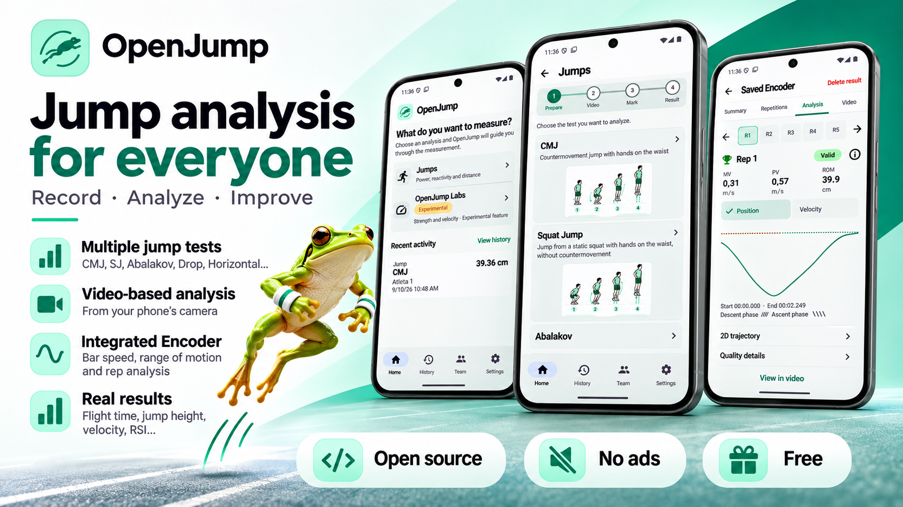
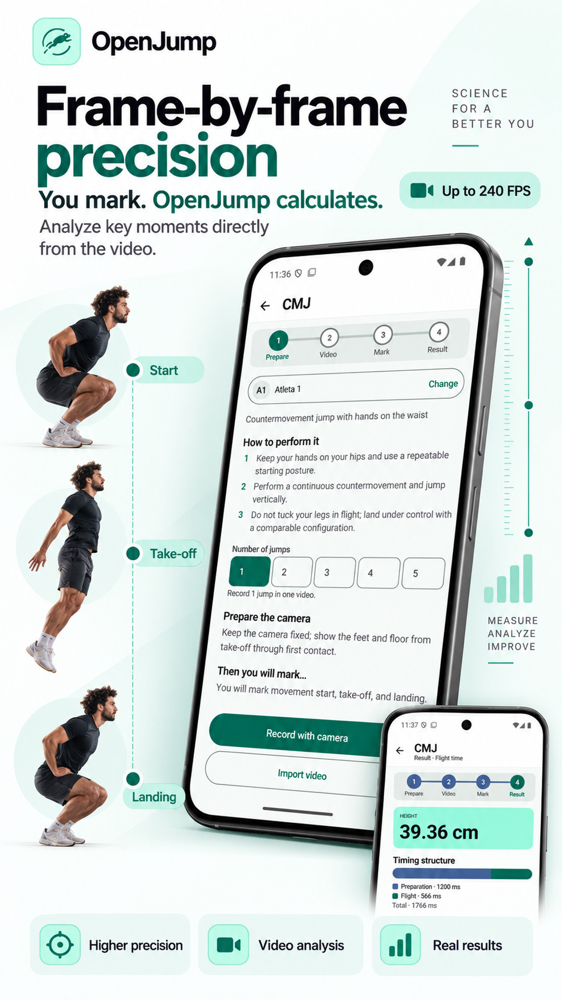
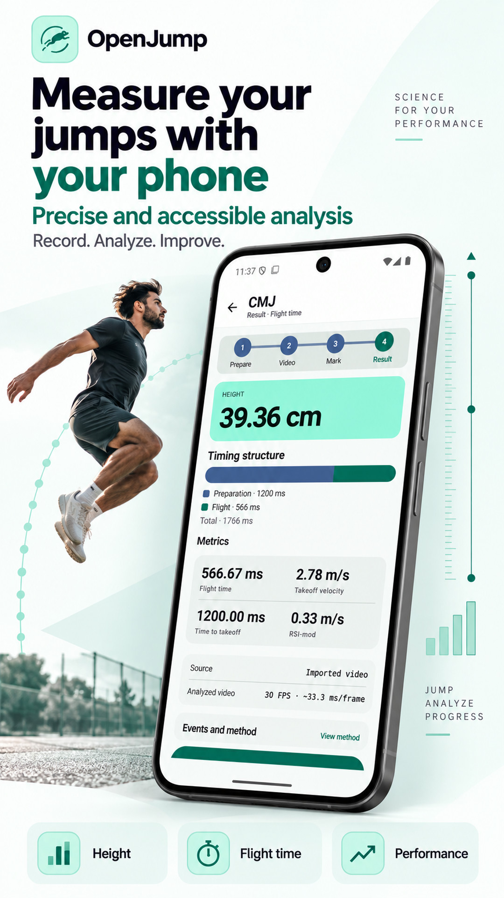
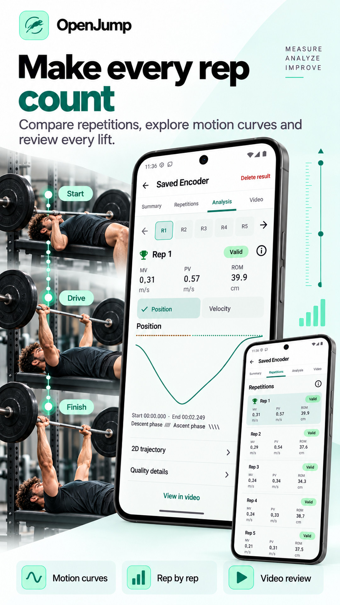
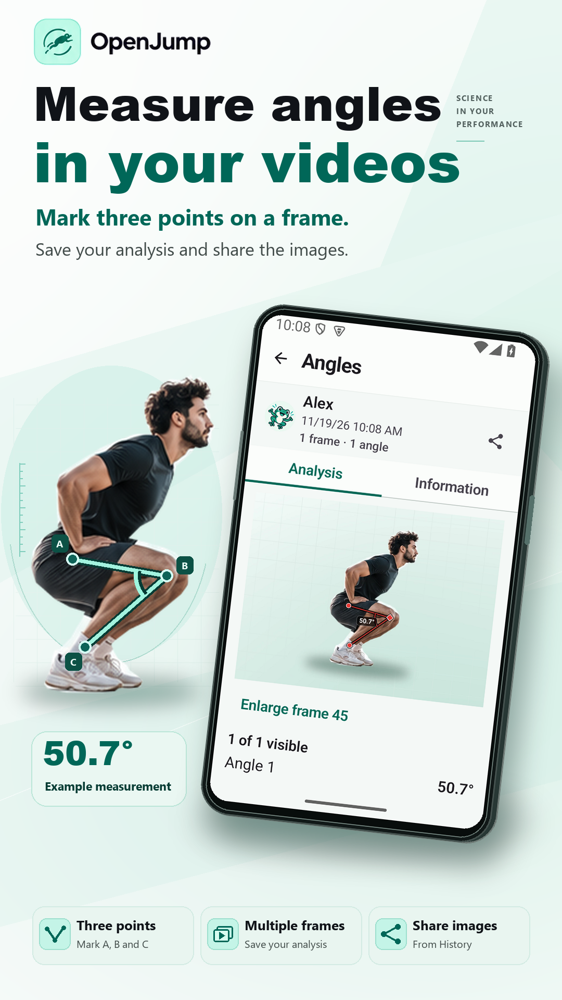
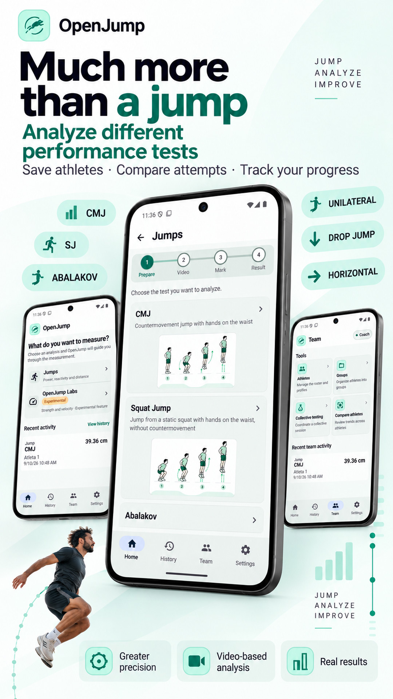
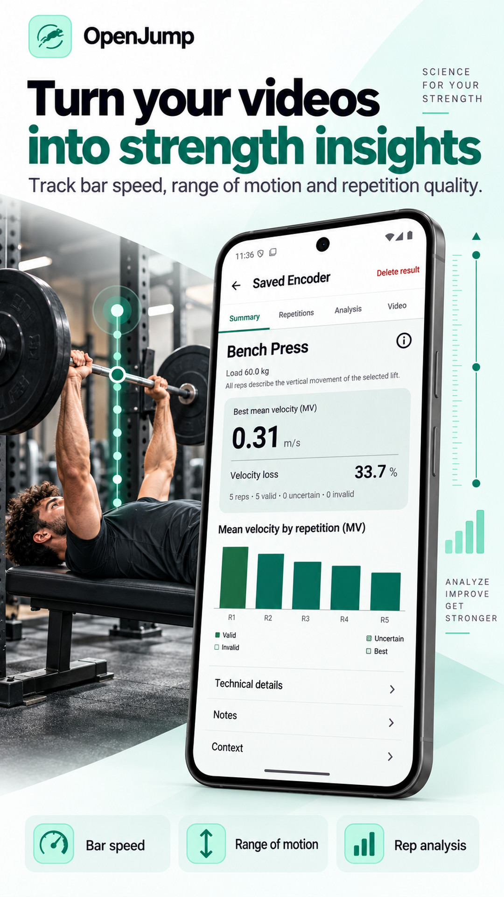

<div align="center">



# OpenJump

**Video analysis for jumps and movement, right on your Android device.**

Record or import a video, mark jump events frame by frame, and measure angles.<br>
Track each athlete’s progress without an account or an internet connection.

**[Get it on Google Play](https://play.google.com/store/apps/details?id=com.openjump.app) · [Get it on F-Droid](https://f-droid.org/packages/com.openjump.app/)**

Android 8.0+ · [GPL-3.0-or-later](LICENSE) · [Changelog](CHANGELOG.md)

</div>

<p align="center">
  
  
  
  
</p>

<details>
<summary>More screenshots</summary>

<p align="center">
  
  
  
</p>

[Store screenshots in other languages](fastlane/metadata/android/)

</details>

## Features

- **Jump analysis.** Record or import a video, mark takeoff and landing frame by frame, and review height, flight time and other metrics depending on the test. Timing uses the video’s actual presentation timestamps, not its nominal frame rate. OpenJump supports CMJ, squat jump, Abalakov, unilateral jump, drop jump and standing horizontal jump.
- **Angle analysis.** Measure angles on individual video frames. Save analyses with multiple frames and view or share their images from History.
- **Athletes and history.** Keep results organised by athlete or team, compare attempts and follow progress. Export data in JSON or CSV, or create a manual backup.
- **Experimental video Encoder.** Calibrate scale, track movement and review repetitions, velocity and trajectories from video. It has not been validated against a physical encoder.

## Privacy and limitations

Analysis runs on your device. No accounts, ads or automatic analytics. Videos and measurements are not uploaded by OpenJump; sharing, exports and backups only happen when you choose them. Manual backups are not encrypted. See the [privacy policy](PRIVACY.md) for details.

OpenJump is a sports-performance tool, not a medical device. Results depend on the recording, camera angle, calibration and the frames you mark.

## Build from source

Requirements: JDK 21 and Android SDK platform 36. Set `ANDROID_HOME` or point `sdk.dir` to your SDK in an untracked `local.properties` file.

```bash
git clone https://github.com/cortig00/OpenJump.git
cd OpenJump
./gradlew :app:assembleDebug :app:lintDebug
```

On Windows, use `gradlew.bat` instead. The debug APK is at `app/build/outputs/apk/debug/app-debug.apk`. See the [F-Droid build and distribution guide](docs/FDROID.md) for release details. Google Play and F-Droid builds use different signing certificates and cannot update one another in place.

## Contribute and support

[Report an issue](https://github.com/cortig00/OpenJump/issues/new) · [Email support](mailto:openjump.app@gmail.com) · [Support development](https://buymeacoffee.com/cortig00)

For bug reports, include the app version, Android version and steps to reproduce. Please don’t share private athlete information or videos.

OpenJump is released under [GPL-3.0-or-later](LICENSE). See the [third-party notices](THIRD_PARTY_NOTICES.md) and [artwork licenses](ASSET_LICENSES.md).
